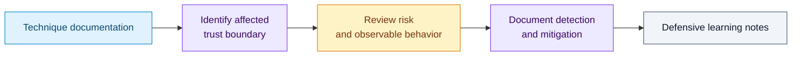

# Offensive Python Scripts

This repository contains a collection of **well-known** attacks/techniques implemented in Python specifically designed for **educational purposes** to demonstrate various offensive attack techniques. These scripts are intended to help casual users, security researchers, penetration testers, and ethical hackers understand how certain attack vectors work and how to protect against them.

---

## A defensive reading map

The collection is organized as separate technique folders. Start with each folder’s documentation, trace the relevant trust boundary, and record how a defender would detect or constrain it.

There is no single application or safe aggregate launcher. Some samples modify files, persistence settings, or security controls; describing them as inherently harmless would be inaccurate. Use source review for a portfolio demonstration and keep any execution inside an explicitly authorized disposable lab.

## 📂 Documentation  
Each script is accompanied by a detailed documentation file located in its respective folder. The documentation includes the following sections:

- **About** – Describes the purpose and function of the script.  
- **Risk** – Outlines potential risks and implications if the script were used maliciously.  
- **Code Block** – Explains the key code blocks and how they function.  
- **Notes** – Highlights important considerations about the script's behavior and security impact.  

---

## ⚠️ Disclaimer  
**All scripts in this repository are STRICTLY FOR EDUCATIONAL PURPOSES ONLY.**   

**TEST IN CONTROLLED ENVIRONMENTS ONLY.**

**Some samples can change host state or expose sensitive information. Educational intent does not make execution harmless.**

These scripts are provided to educate users, security researchers, and developers about potential security vulnerabilities so that they can better understand and mitigate such threats. Any misuse of these scripts is strictly prohibited. The author is not responsible for any damages caused by the misuse of the code.

---

## 🙏 Acknowledgements  
Some constructs and concepts used in this repository were introduced by **Instructor Howard Poston** during a course held by **Infosec**. I am deeply grateful to them for their guidance and for introducing me to these concepts.

---

## 📜 License
This project is licensed under the [BSD-3-Clause](LICENSE).

## Contact

For any inquiries or support, please contact:

- **Author**: C0deRhin0 
- **GitHub**: [C0deRhin0](https://github.com/C0deRhin0)

---
